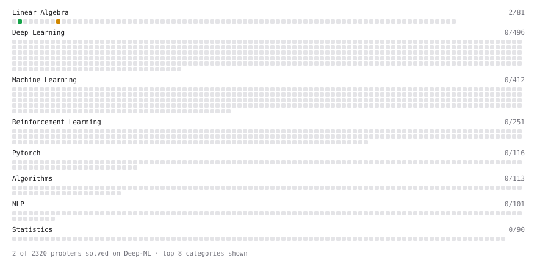

# Deep-ML

My machine learning practice from [Deep-ML](https://www.deep-ml.com). Every solution here was written by hand.

**4** solved · 2 problems · 0 labs · 2 math

[**Browse the interactive portfolio**](https://dunstanad.github.io/deep-ml/) to replay this filling in over time.

## Problems

| | Difficulty | Solved | |
| --- | --- | --- | --- |
| [Transpose of a Matrix](https://www.deep-ml.com/problems/2) | easy | 2026-11-12 | [solution](problems/0002-transpose-of-a-matrix) |
| [Matrix times Matrix ](https://www.deep-ml.com/problems/9) | medium | 2026-11-12 | [solution](problems/0009-matrix-times-matrix) |

## Math

| | Difficulty | Solved | |
| --- | --- | --- | --- |
| [Inverse and Rank](https://www.deep-ml.com/math-problems/12) | medium | 2026-11-13 | [solution](math/0012-inverse-and-rank) |
| [Schur Complements and the Partitioned Inverse](https://www.deep-ml.com/math-problems/409) | medium | 2026-11-16 | [solution](math/0409-schur-complements-and-the-partitioned-inverse) |

---

_This file is regenerated by Deep-ML on every push._
